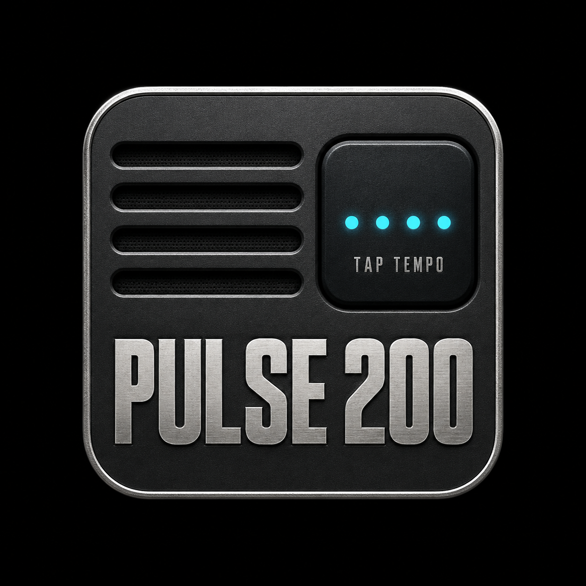
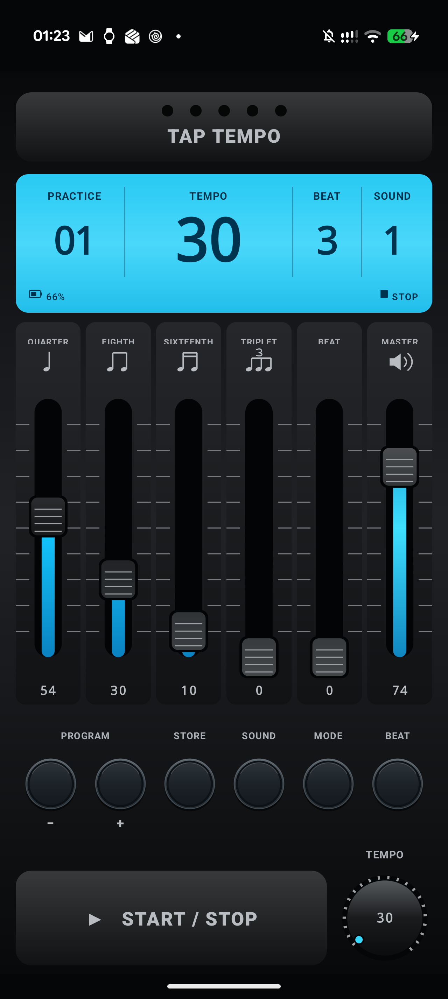

<p align="center">
  
</p>

<h1 align="center">Pulse 200</h1>

<p align="center">A hardware-inspired Android metronome for drum practice.</p>

<p align="center">
  <a href="https://github.com/franx82/Pulse200/releases">Download APK</a> ·
  <a href="#build-from-source">Build from source</a> ·
  <a href="docs/PIANO-INTERVENTI-REVIEW.md">Development plan</a>
</p>

Pulse 200 brings the hands-on feel of the TAMA RW200 to Android: a large tempo display, dedicated subdivision faders, tap tempo, and quick access to saved programs. The interface is built with Jetpack Compose, with audio generated by a native C++ engine using Oboe.

<p align="center">
  
</p>

## Features

- **30–250 BPM**, adjusted with tap tempo or a vertical drag on the tempo knob. Slow drags provide finer control.
- **Six independent faders** for quarter notes, offbeat eighths, sixteenths, triplets, the first-beat accent, and master volume.
- **Two synthesized sound sets**, with distinct pitches for subdivisions and accents.
- **30 saved programs**, each storing tempo and beat count. Mixer levels, sound selection, and mode remain global.
- **Practice and Stage modes**: continuous playback, or an eight-bar run that advances to the next program and waits.
- **Background playback** through an Android foreground service, plus saved settings between sessions.

## Get the app

Download the APK from [GitHub Releases](https://github.com/franx82/Pulse200/releases) and install it on your Android device.

Current builds require **Android 8.0 or later** and an **ARM64 device**. The app has been built and tested on a Pixel 10 Pro running Android 17.

Releases currently contain **debug APKs**. The screenshot and source on `main` may include changes newer than the latest downloadable release.

## Controls

| Control | Action |
|---|---|
| **TAP TEMPO** | Tap at least five times to set the tempo. The BPM display flashes briefly after measurement. |
| **TEMPO knob** | Drag up to increase the tempo or down to decrease it. |
| **Faders** | Tap or drag anywhere across the scale to adjust a level; double-tap to set it to zero. |
| **PROGRAM − / +** | Select one of 30 program slots, wrapping at either end. |
| **STORE** | Save the current tempo and beat count. Hold to toggle the simulated display backlight. |
| **SOUND** | Switch between the two sound sets. |
| **MODE** | Select Practice or Stage. |
| **BEAT** | Cycle through 0–9 beats per bar; 0 disables the first-beat accent. |
| **START / STOP** | Start or stop playback. |

The eighth-note fader adds only the offbeat; the sixteenth-note fader adds the second and fourth sixteenths. Triplets play all three notes. With **BEAT 0**, Stage counts one click as one bar.

## Build from source

The project includes the Gradle wrapper. You need:

| Tool | Version |
|---|---|
| JDK | 21 |
| Android SDK platform | 36 |
| Android NDK | 27.2.12479018 |
| CMake | 3.22.1 |

Set `ANDROID_HOME` to your SDK directory, or set `sdk.dir` in an untracked `local.properties` file. Then run:

```sh
git clone https://github.com/franx82/Pulse200.git
cd Pulse200
./gradlew assembleDebug
```

The first build downloads Gradle dependencies and Oboe 1.9.3, so it needs internet access and Git.

The APK is written to:

```text
app/build/outputs/apk/debug/app-debug.apk
```

To run Android lint:

```sh
./gradlew lintDebug
```

The application ID remains `com.rhythmwatch` for compatibility with existing installations. Updating without losing app data also requires the same signing key.

Run the Android unit tests, lint, and debug build with:

```sh
./gradlew testDebugUnitTest lintDebug assembleDebug
```

The native renderer tests can be run independently with CMake and CTest:

```sh
cmake -S tests/native -B /tmp/pulse200-native-build -DCMAKE_BUILD_TYPE=Debug
cmake --build /tmp/pulse200-native-build
ctest --test-dir /tmp/pulse200-native-build --output-on-failure
```

## Development status

Pulse 200 is a **development preview**. The reviewed timing, playback ownership, mode, and Tap Tempo fixes are implemented, with deterministic native and Android unit tests. The local native tests, Android unit tests, lint, and debug build pass; the APK also passes the 16 KB alignment check.

On the Pixel, the user reports successful checks for start/stop, background playback and notifications, Practice/Stage, Tap Tempo, settings persistence, portrait/landscape layouts, larger text, TalkBack, and resizing in split-screen. Output changes, explicit Activity recreation, and acoustic latency remain unverified. [GitHub Actions run 39170284060](https://github.com/franx82/Pulse200/actions/runs/39170284060) passed native and Android tests, lint, and APK build, then uploaded the `Pulse200-debug` artifact. Release signing is not configured. The [implementation plan](docs/PIANO-INTERVENTI-REVIEW.md) tracks the remaining checks and distribution decisions; the plan is currently in Italian.

Sounds are synthesized rather than recordings of the original hardware. Pulse 200 is an independent project inspired by the RW200 and is not affiliated with TAMA.
