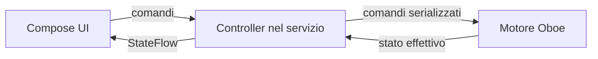

# Pulse 200 — piano degli interventi dalla code review

Aggiornato il 18 ottobre 2026. Riferimento: review completa del codice eseguita sul checkout locale, incluse le modifiche successive alla release `v0.9.0`.

Questo documento ordina i lavori emersi dalla review. Le caselle restano non selezionate finché l’intervento e i relativi criteri di verifica non sono stati completati. Il piano non autorizza una pubblicazione: commit, tag e release si valutano separatamente.

## Ordine di lavoro

| Fase | Ambito | Priorità | Dipende da |
|---|---|---:|---|
| 1 | Timing e schedulazione audio | P1 | — |
| 2 | Proprietà del motore e lifecycle | P1/P2 | Fase 1 per la verifica end-to-end |
| 3 | Modalità Stage/Practice e Tap Tempo | P2 | Fase 2 per stato coerente |
| 4 | Build automatica e regressioni | P2 | Fasi 1–3 per coprire il comportamento corretto |
| 5 | Adattamento schermo e accessibilità | Miglioramento | — |
| 6 | Audio di sistema, persistenza e robustezza | Miglioramento | Fase 2 per integrazione audio |
| 7 | Preparazione di una release stabile | Prima della distribuzione | Fasi precedenti |

## Fase 1 — rendere corretto il riferimento temporale audio

Riferimenti principali: [`rhythm_engine.cpp`](../app/src/main/cpp/rhythm_engine.cpp), in particolare schedulazione e rendering del callback.

- [ ] **F01 — Non anticipare né perdere eventi nel blocco audio.** Conservare gli eventi futuri come pendenti o suddividere il rendering del blocco ai loro campioni; non attivare una voce prima del relativo `startFrame`. Supportare più eventi della stessa voce nello stesso blocco senza sovrascriverli.
- [ ] **F02 — Usare un’unica griglia musicale frazionaria.** Derivare quarti e suddivisioni dallo stesso riferimento temporale, arrotondando la posizione del singolo evento e non il periodo da sommare ripetutamente. Un cambio BPM deve mantenere una fase coerente.
- [ ] **F04 — Iniziare il conteggio quando il motore passa davvero a PLAY.** Una callback silenziosa precedente non deve consumare il reset né far saltare il primo colpo.
- [ ] Aggiungere test deterministici del renderer per evento al campione corretto, eventi ravvicinati/sovrapposti, deriva su tempi non divisibili e primo colpo dopo start.

**Criteri di completamento**

- Nessun campione della voce è udibile prima del campione programmato; gli eventi nello stesso blocco vengono tutti resi.
- La griglia delle suddivisioni non accumula deriva rispetto ai quarti nei test prolungati a BPM non divisibili.
- Il primo beat è emesso con la latenza prevista anche se il callback parte prima del comando PLAY.
- Restano invariati pattern e suoni concordati: ottavi al levare, sedicesimi sul secondo e quarto sedicesimo, terzine su tutti e tre i colpi; pitch, gain e timbri approvati.

## Fase 2 — affidare playback e stato a un solo proprietario

Riferimenti: [`MetronomeService.kt`](../app/src/main/java/com/rhythmwatch/MetronomeService.kt), [`AudioEngine.kt`](../app/src/main/java/com/rhythmwatch/AudioEngine.kt), [`MainActivity.kt`](../app/src/main/java/com/rhythmwatch/MainActivity.kt) e il motore nativo.

- [ ] **F03 — Rendere lo stato di riproduzione indipendente dall’Activity.** Il servizio/controller possiede playback, modalità della sessione e completamento Stage. La UI osserva lo stato effettivo e invia comandi; ricreare l’Activity non deve mostrare uno stato falso o perdere il cambio programma previsto.
- [ ] **F06 — Serializzare start, stop, reset e close.** Usare un solo proprietario e una sola coda/serializzazione dei comandi; eliminare chiusure concorrenti da facade distinti e thread non tracciati. Una chiusura vecchia non deve poter fermare una sessione nuova.
- [ ] **F05 — Recuperare in modo coerente da disconnessione audio.** Invalidare lo stream chiuso, riportare al controller lo stato reale e definire riapertura oppure arresto con errore visibile. Non dichiarare PLAY se l’uscita non è attiva.
- [ ] Verificare transizioni rapide START/STOP, passaggio in background, ritorno in app e ricreazione dell’Activity. Eseguire sul Pixel anche almeno una prova di cambio uscita/cuffie quando disponibile.

**Criteri di completamento**

- UI, notifica e motore mostrano lo stesso stato dopo ricreazione, background/foreground e disconnessione.
- Comandi rapidi e ripetuti non lasciano stream doppi, sessioni fantasma o stop tardivi.
- Il percorso audio ordinario resta privo di I/O, allocazioni esplicite e attese su mutex nel callback.

## Fase 3 — allineare modalità e Tap Tempo allo stato reale

- [ ] **F07 — Definire quando MODE diventa attivo durante una sessione.** Scegliere una semantica unica (per esempio al prossimo avvio oppure al confine della battuta), rappresentarla correttamente sul display e applicarla nel controller. Mantenere identici gli accenti tra Practice e Stage: cambia soltanto la conclusione automatica dopo otto battute.
- [ ] **F08 — Calcolare il Tap Tempo dalla media degli intervalli.** Usare `60000 / media(intervalli)` con esclusione degli intervalli non validi. Conservare la soglia dei cinque tocchi e il lampeggio veloce di un secondo già verificati sul fisico.
- [ ] Aggiungere test per tempi regolari e irregolari, timeout della sequenza, limiti BPM e transizioni MODE concordate.

**Criteri di completamento**

- Il BPM calcolato corrisponde alla durata media dei beat toccati.
- Il testo Practice/Stage non contraddice il comportamento del motore.
- Stage termina dopo otto battute; Practice continua; il passaggio non introduce accenti diversi.

## Fase 4 — ripristinare una pipeline verificabile

Riferimento: [workflow Android](../.github/workflows/android.yml).

- [ ] **F10 — Correggere l’installazione SDK del workflow.** Rimuovere il pacchetto Android `tools` non più disponibile dalla configurazione o usare componenti SDK validi già presenti sul runner.
- [ ] Eseguire nella pipeline compilazione, lint e test deterministici introdotti nelle fasi audio e di stato.
- [ ] Verificare che un errore in ciascun passaggio fallisca la run e che l’APK venga pubblicato come artefatto solo dopo controlli riusciti.

**Criterio di completamento:** una nuova run GitHub Actions completa build, controlli e upload senza errori; il link della run e l’artefatto vengono annotati qui o nelle note della release.

## Fase 5 — layout adattabile e accessibile

- [ ] **F09 — Rivedere il layout per schermi bassi e landscape.** Prevedere una variante compatta mantenendo l’interfaccia senza scroll. Verificare anche dimensioni font di sistema maggiori.
- [ ] Controllare che label e controlli non vengano tagliati e che i fader conservino area touch larga quanto la scala ai loro lati.
- [ ] Aggiungere semantica TalkBack e azioni accessibili per START/STOP, Tap, programmi, modalità, beat, manopola e fader (valore/range inclusi). Verificare attivazione senza gesti di trascinamento.
- [ ] Verificare una matrice minima: Pixel portrait, display più basso, landscape e font ingrandito.

**Criterio di completamento:** nessuna sovrapposizione o contenuto irraggiungibile nella matrice; tutte le funzioni essenziali sono identificabili e azionabili con screen reader.

## Fase 6 — comportamento di sistema e robustezza

- [ ] Definire e implementare la politica di audio focus e la risposta alla perdita/cambio dell’uscita, tenendo conto dell’uso del metronomo insieme a basi musicali.
- [ ] Rendere la notifica di playback utile e coerente con il controller; valutare permesso notifiche e azione STOP in notifica secondo le versioni Android supportate.
- [ ] Accorpare i salvataggi delle preferenze durante il movimento continuo dei fader, mantenendo l’aggiornamento sonoro immediato.
- [ ] Correggere i casi limite del gesto tempo: velocità iniziale basata su timestamp coerenti e inversione dopo aver raggiunto 30/250 BPM senza zona morta.
- [ ] Validare lato JNI la lunghezza dell’array e i valori finiti prima di leggere/applicare i livelli.
- [ ] Aggiungere diagnostica debug per sample rate, frames-per-burst, buffer, xrun e stato stream. Usarla per misurare prima di eventuali ottimizzazioni o smoothing.

## Fase 7 — preparare la distribuzione stabile

- [ ] Decidere il canale di distribuzione e custodire una chiave di firma stabile fuori dal repository, con backup recuperabile.
- [ ] Configurare la firma release senza includere segreti nel codice o nei log; verificare aggiornamento sopra l’APK installato mantenendo preferenze e dati.
- [ ] Incrementare versione e note per la prossima release; documentare che `v0.9.0` non include le modifiche attualmente presenti su `main`.
- [ ] Produrre e verificare APK firmato, checksum e procedura di aggiornamento prima di pubblicare.

## Migliorie non bloccanti

- [ ] Separare gradualmente stato/controller, archivio programmi e componenti grafici dalla `MainActivity`, senza introdurre complessità architetturale non necessaria.
- [ ] Valutare il salvataggio della preferenza di retroilluminazione se deve sopravvivere alla riapertura dell’app.
- [ ] Confrontare sul Pixel il timbro BEAT fra Sound 1 e Sound 2 solo se si vuole che sia identico in ogni dettaglio: il pitch è uguale per decisione, ma timbro e inviluppo dipendono ancora dal suono selezionato. Nessuna modifica finché l’ascolto approvato non indica un problema.

## Vincoli funzionali da mantenere

- Mixer e SOUND restano globali; i preset memorizzano solo BPM e numero di beat.
- 30 programmi circolari; i dati preesistenti continuano a essere leggibili.
- Sound 1: quarter/eighth/sixteenth C#7, triplet C#6, beat F#7. Sound 2: quarter/eighth/sixteenth B5, triplet B4, beat F#7.
- BEAT senza il precedente boost di 6 dB; nessuna modifica non richiesta a pitch o timbro.
- Stage dura otto battute e differisce da Practice solo per l’arresto automatico.
- Il metronomo deve continuare in background; l’interfaccia principale resta a tutto schermo, responsive e senza scroll.
- Impostazioni correnti ricordate alla riapertura, senza riprendere automaticamente l’audio.

## Note di avanzamento

- Review iniziale: 18 ottobre 2026.
- Correzioni di codice incluse in questo piano: nessuna.
- Modifiche locali già presenti prima del piano: `README.md`, `app/build.gradle.kts`, `app/src/main/cpp/CMakeLists.txt`, `app/src/main/java/com/rhythmwatch/MainActivity.kt`. Non annullarle durante gli interventi.
